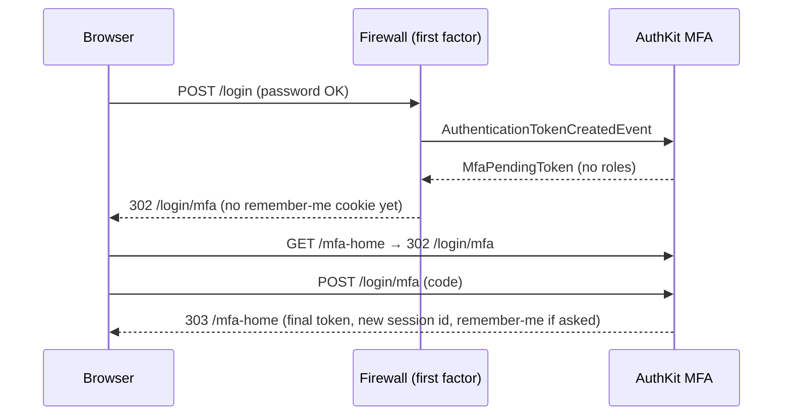

# Two-factor authentication (MFA)

Native second factor since **1.34**, opt-in per profile (`mfa.enabled: false` by default: no service, route, entity
mapping with `doctrine.register_mapping: auto`, cookie or listener). Authenticator apps (TOTP, RFC 6238) with
one-time recovery codes, "trust this device", required roles with a grace period, and an administrator reset.
WebAuthn and e-mail codes are on the [roadmap](ROADMAP.md).

## Table of contents

- [How it works](#how-it-works)
- [Enable](#enable)
- [Configuration reference](#configuration-reference)
- [First factors](#first-factors)
- [Remember-me](#remember-me)
- [Required MFA and grace period](#required-mfa-and-grace-period)
- [Trusted devices](#trusted-devices)
- [Recovery codes](#recovery-codes)
- [Pages and the account card](#pages-and-the-account-card)
- [Administrator reset](#administrator-reset)
- [PHP API](#php-api)
- [Audit events](#audit-events)
- [UserKit sessions](#userkit-sessions)
- [Personal data (UserKit)](#personal-data-userkit)
- [Impersonation](#impersonation)
- [Database schema](#database-schema)
- [Security notes](#security-notes)

## How it works

1. Any first factor succeeds (password, magic link, social / SSO, sign-up auto-login, invitation acceptance; QR login
   is exempt by default). On the security event `AuthenticationTokenCreatedEvent` — before the token is stored —
   AuthKit replaces the token with an `Mfa\Security\MfaPendingToken` when the user has MFA (and the browser is not
   trusted) or must enrol now.
2. The pending token has **no roles** and wraps the first factor's token. Every request is sent to
   `/login/mfa` (HTML: redirect, the GET target is kept; JSON / XHR: `401 {"error":"mfa_required"}`), except the
   challenge, the enrolment page, logout and `mfa.allowed_routes`. `access_control` and voters refuse it anyway.
   Note: `MfaPendingToken::getUser()` returns the real user, so on those routes (and in kernel listeners) test roles
   or `IS_AUTHENTICATED_FULLY`, not `app.user` / `getUser() !== null`, to know whether the sign-in is complete.
3. A valid code restores the first factor's token, migrates the session id, issues the remember-me cookie the user
   asked for, dispatches `MfaChallengePassedEvent` + `MfaLoginCompletedEvent` and redirects to the original target.
4. A pending sign-in expires after `pending_lifetime` (300 s) and ends after `max_attempts` (5) wrong codes.



## Enable

```yaml
# config/packages/nowo_auth_kit.yaml
nowo_auth_kit:
    mfa:
        enabled: true
        issuer: 'Acme'                       # the name authenticator apps show (required)
        required_roles: [ROLE_ADMIN]         # optional: these users must enrol (grace period, then forced)
```

- The TOTP secret is stored with `#[Encrypted]`: register and configure `nowo-tech/doctrine-encrypt-bundle`
  (`mfa.require_encryption: true` refuses to compile without it; set it to `false` only for tests and demos).
- Install `endroid/qr-code` for the server-rendered QR code (without it the page shows the key for manual entry).
- MFA needs form CSRF protection and `symfony/lock` (`lock.factory`, so attempt limits are atomic; use a shared store
  such as Redis or a database on several hosts): the container refuses to compile without them.
- Create the tables: `php bin/console doctrine:migrations:diff` then migrate.
- `access_control`: the challenge lives under `/login` (`PUBLIC_ACCESS` like the login page; the pending token has
  no roles); the account page under `/account/security/mfa` (`ROLE_USER`).

## Configuration reference

| Key | Default | Description |
| --- | --- | --- |
| `mfa.enabled` | `false` | Turn MFA on for the profile |
| `mfa.issuer` | `null` | Name in authenticator apps; required when enabled |
| `mfa.require_encryption` | `true` | Refuse to compile without DoctrineEncryptBundle |
| `mfa.totp.digits` / `period` / `window` | `6` / `30` / `1` | RFC 6238 parameters; `window` = accepted clock skew in steps (0–2) |
| `mfa.recovery_codes.count` / `low_warning` | `10` / `3` | Codes per set; the account page warns at or below `low_warning` |
| `mfa.required_roles` | `[]` | Roles (hierarchy aware) that must have MFA |
| `mfa.policy` | `null` | Service id of an `Mfa\MfaPolicyInterface` (host rules) |
| `mfa.grace_period` | `604800` | Seconds a required user may still sign in without MFA; `0` = enrol at the next sign-in |
| `mfa.pending_lifetime` | `300` | Seconds a sign-in may wait for its code |
| `mfa.max_attempts` | `5` | Wrong codes per pending sign-in |
| `mfa.recent_sign_in` | `900` | Seconds after a full sign-in during which the account page may set up the second factor; later the user signs in again first |
| `mfa.rate_limit.account` / `ip` | `10`/`900`, `30`/`900` | Failures per account / client IP and window (valid codes give their IP slot back); at the account limit codes are refused (lockout) |
| `mfa.first_factors.*` | see [First factors](#first-factors) | `required` or `exempt` per first factor |
| `mfa.remember_me` | `trusted` | `trusted` or `challenge` (see [Remember-me](#remember-me)) |
| `mfa.trusted_devices.lifetime` / `max` | `2592000` / `5` | "Trust this device" duration (0 = off) and maximum (UserKit's `maxTrustedDevices` wins) |
| `mfa.trusted_devices.password_field` | `password` | Mapped user field holding the password hash; a change forgets the trusted devices |
| `mfa.allowed_routes` | `[]` | Extra routes reachable while pending (locale switch…) |
| `mfa.hash_secret` | `null` → `%kernel.secret%` | HMAC key of recovery codes and device tokens |
| `mfa.admin.routes` / `access_roles` | `false` / `[ROLE_ADMIN]` | Optional administrator reset page |
| `mfa.routes.<key>.path` / `.name` | see below | Paths and names (unique across profiles) |

Routes: `challenge` `/login/mfa`, `setup` `/login/mfa/setup`, `account` `/account/security/mfa`, `enable`, `disable`,
`recovery_codes`, `forget_device` (`/account/security/mfa/…`), `admin_reset` `/admin/mfa/{user}` (only with
`admin.routes: true`).

## First factors

| Key | Default | Sign-in |
| --- | --- | --- |
| `form_login` | `required` | Password form |
| `login_link` | `required` | Magic link (firewall check route or the confirm interstitial) |
| `social` | `required` | Social login / SSO (`exempt` trusts the identity provider's own MFA) |
| `registration` | `required` | Auto-login after sign-up |
| `invitation` | `required` | Auto-login after accepting an invitation |
| `qr` | `exempt` | QR login: the approving phone session already passed MFA |
| `default` | `required` | Any other authenticator (host `Security::login()` calls…) |

`exempt` never skips the forced enrolment of a required user.

## Remember-me

The remember-me cookie is never issued by the first factor alone: the wish is kept and the cookie is issued when the
second step completes. With `remember_me: trusted` (default) a remember-me sign-in is not challenged again (the cookie
proves a completed second step). With `challenge`, every remember-me sign-in is challenged unless the browser is a
trusted device. Disabling, re-enrolling or resetting MFA bumps the UserKit remember-me epoch (older cookies die).

## Required MFA and grace period

A user is required when one of `required_roles` is reachable, or when the `mfa.policy` service says so:

```php
final class OrganizationMfaPolicy implements MfaPolicyInterface
{
    public function requirement(UserInterface $user, string $profile): MfaRequirement
    {
        return $user instanceof User && $user->belongsToStrictOrganization() ? MfaRequirement::Required : MfaRequirement::Optional;
    }
}
```

The grace period starts at the first sign-in after the requirement appeared. Meanwhile pages may show a reminder
(`auth_kit_mfa_notice()`); afterwards the first factor leads to `/login/mfa/setup`, where the user can only enrol or
sign out. After an administrator reset the grace is zero.

## Trusted devices

"Trust this device" (on the challenge) stores the HMAC of a random token with an expiry; the browser keeps the token
in an httpOnly, SameSite=Lax cookie (`__Host-nowo_auth_kit_mfa_device` on HTTPS) holding up to ten tokens (one per
account). A trusted browser skips the TOTP step (never the forced enrolment); the token is rotated on every use. The
limit is UserKit's `maxTrustedDevices` when set, else `trusted_devices.max`; over it the least recently used device is
forgotten. Devices are forgotten on disable, re-enrolment, admin reset, and UserKit sign-outs everywhere / by an
administrator / account disabled / password changed. With UserKit and a device id resolver, forgetting a device on
the account page also signs that device's sessions out (`revokeDevice()`), keeping the current one.

## Recovery codes

Ten codes of ten Crockford Base32 characters (`ABCDE-12345`), shown **once** after enrolment and on regeneration, with
a download link (built in the page, no request). Only their HMAC is stored; each works once (conditional `UPDATE`).
Input ignores case, dashes and spaces and maps `O`→`0`, `I`/`L`→`1`. Regenerating replaces all of them and needs a
current code.

## Pages and the account card

| Page | Template | Notes |
| --- | --- | --- |
| Challenge | `web_ui.templates.mfa_challenge` (`@NowoAuthKitBundle/mfa/challenge.html.twig`) | Auth scaffold; code, recovery code (`<details>`), trust device, sign out |
| Forced enrolment | `web_ui.templates.mfa_setup` | QR + key (`mfa/_enrolment.html.twig`), code |
| Recovery codes after enrolment | `web_ui.templates.mfa_recovery_codes` | Codes, download, Continue |
| Account page | `@NowoAuthKitBundle/mfa/account.html.twig` | UiKit admin layout; enrol, disable, new codes, trusted devices |
| Admin reset | `@NowoAuthKitBundle/mfa/admin_reset.html.twig` | Status (never the secret), reset form |

Account card for the host's own account page:

```twig
{{ include('@NowoAuthKitBundle/mfa/_account.html.twig') }}

<div class="banner">{{ 'mfa.account.required_until'|trans({'%date%': mfa.graceEndsAt|date('Y-m-d')}, 'NowoAuthKitBundle') }}</div>
```

Twig: `auth_kit_mfa_status(user = null)` (`MfaStatus`), `auth_kit_mfa_notice()`, `auth_kit_mfa_account_path()`.
Every page answers `private, no-store`, `X-Frame-Options: DENY`, `Referrer-Policy: no-referrer`.

## Administrator reset

PHP API (Beacon calls it from its own user administration):

```php
$mfa->reset($user, $administrator); // false when the user had no MFA
```

It clears the secret, recovery codes and trusted devices without revealing anything, signs every session of the user
out with the remember-me epoch (UserKit), makes a required user enrol at the next sign-in, and dispatches
`MfaResetByAdminEvent`. The optional page (`mfa.admin.routes: true`, `/admin/mfa/{identifier}`) needs one of
`mfa.admin.access_roles`, is CSRF-protected, refuses one's own account and impersonators.

## PHP API

`Nowo\AuthKitBundle\Mfa\MfaManager` (public service): `status($user)`, `isEnabled($user)`, `requirement($user)`,
`reset($user, $actor)`, `forgetDevices($user, $reason, $publicId, $request)`, `forgetUser($user)`. Enrolment,
code checks and disabling run through the pages (the step-up code is checked there).

## Audit events

Dispatched after the write; none carries a secret, code, URI or token: `MfaEnabledEvent`, `MfaDisabledEvent`,
`MfaResetByAdminEvent` (`actor`), `MfaRecoveryCodesRegeneratedEvent`, `MfaRecoveryCodeUsedEvent` (`remaining`),
`MfaChallengeFailedEvent` (`kind`: `totp` / `recovery`, `context`: `challenge` / `step_up`), `MfaLockedOutEvent`,
`MfaChallengePassedEvent` (`method`: `totp`, `recovery`, `trusted_device`, `enrolment`; `firstFactor`),
`MfaLoginCompletedEvent` (`token`, `request`, `firstFactor`), `MfaTrustedDeviceAddedEvent` (`device`),
`MfaTrustedDevicesForgottenEvent` (`reason`, `count`).

`LoginSuccessEvent` still fires at the first factor. Host listeners that must not run for a half-authenticated user
skip `$event->getAuthenticatedToken() instanceof MfaPendingToken` or listen to `MfaLoginCompletedEvent`.

## UserKit sessions

With UserKit ≥ 1.11 sessions: the pending token carries the attribute `nowo.authentication_pending`, so UserKit
registers the session (concurrent-session limit included) only once the second step completes; disabling or
re-enrolling signs the user's other sessions out (`revokeOthers`, epoch); an admin reset signs every session out
(`revokeAll`, epoch); "sign out everywhere", account disabled, password changed forget trusted devices; deleting
every session of a removed user (`forgetUser()`, eraser) deletes the user's second factor.

## Personal data (UserKit)

Since **1.36**, with UserKit installed and `nowo_user_kit.personal_data.enabled: true`, AuthKit registers:

- the eraser `auth_kit_mfa` (`MfaPersonalDataEraser`, tag priority **200**, before host erasers): deletes the
  user's TOTP secret, recovery codes and trusted devices (`MfaManager::eraseUser()`, DBAL deletes inside UserKit's
  erasure transaction, no flush). Rows are found by the owner reference (user class and id), so an anonymised e-mail
  does not hide them;
- the export section `mfa` (`MfaPersonalDataExportProvider`, priority -50): `profile`, `method` (`totp`), `enabled`,
  `enabled_at`, `required_since`, `reset_at`, `unused_recovery_codes` (a number) and `trusted_devices` (`label`,
  `created_at`, `last_used_at`, `expires_at`). Never the secret, the recovery codes or device tokens; `null` for a user
  who never enrolled (`MfaManager::exportUser()`).

The MFA tables reference the user by owner type and id without a foreign key (any user class); hosts that delete user
rows physically keep this eraser in their deletion flow (or call `MfaManager::forgetUser()`).

## Impersonation

`switch_user` builds its token without the authenticator manager, so it gets no second step: the impersonator already
passed MFA. The account pages and the admin reset refuse a `SwitchUserToken` (an impersonator can neither read nor
change the user's factor), and a pending token has no roles to impersonate with.

## Database schema

`auth_kit_mfa` (owner = Doctrine root class + id, encrypted secret, enabled date, last used step, grace start, reset
audit), `auth_kit_mfa_recovery_code` (HMACs, used date), `auth_kit_mfa_trusted_device` (public id, token HMAC, label,
UserKit device id, dates). All table-prefix aware. Owners are stable ids, never e-mails: changing an e-mail keeps the
factor.

## Security notes

- The secret exists only in the session during enrolment, is stored encrypted, and is shown only on the enrolment
  page; the QR code is rendered on the server (no third-party QR service); the `otpauth://` URI is never logged,
  flashed, cached or put in a URL.
- Replay: a time step is accepted once (conditional `UPDATE … last_used_step < :step`); window ±1 step.
- Rate limits: attempts per pending sign-in (a server-side counter keyed by the pending sign-in's random id), per
  account (lockout, `MfaLockedOutEvent`) and per client IP, each attempt **consumed atomically before** the code is
  verified under `symfony/lock` (concurrent guesses cannot share a check-then-act window; required at compile time);
  only wrong codes keep their IP slot (a busy shared NAT is not locked out); constant-time comparisons; the challenge is only
  reachable with a pending token (no "does this account have MFA" oracle).
- The forced enrolment is bound to its pending sign-in: if MFA was turned on elsewhere meanwhile, the sign-in restarts.
- The account page needs a full sign-in (`IS_AUTHENTICATED_FULLY`; a remember-me session signs in again first), and
  setting up the second factor needs a sign-in within `mfa.recent_sign_in` (15 min): a hijacked long-lived session
  cannot bind the attacker's authenticator. Disable and new recovery codes ask for a current code.
- The admin reset refuses accounts holding a role the administrator does not hold.
- A password change (any flush of `mfa.trusted_devices.password_field`, default `password`) forgets the trusted
  devices, with or without UserKit.
- The unconfirmed enrolment secret stays in the session for at most 300 s (in clear in the session store: protect the
  session storage as you protect sessions).
- Session id migrated on completion; every POST CSRF-protected.
- New-device notifications (Device Intelligence) still fire at the first factor (an alert when a password is used).
